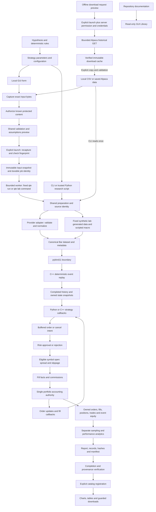
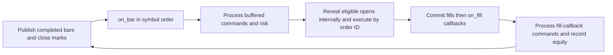

# QTE test build: data flow and strategy development

This is a local research/backtesting build, not an account-connected trading
system. Synthetic results test mechanics; they do not establish profitable alpha.

## Start it

From `/home/glsu6/Documents/qte`:

```sh
.venv/bin/python -m qte gui
```

Open `http://127.0.0.1:8765/research` and enter the one-time terminal code.
Keep the terminal open; Ctrl-C stops it. No package installation is needed.

For a first **New run**, use the following existing example fixture:

| Field | Value |
|---|---|
| Adapter / path | CSV / `examples/research-bars.csv` |
| Interval ns | `3600000000000` |
| Action-free declaration | Checked for this known example fixture |
| Strategy / symbol | Moving average regime / `SPY` |
| Fast / slow / quantity | `2` / `3` / `10` |
| Initial cash | `100000` |

Choose **Preview assumptions**, inspect costs/risk/data assumptions, then
**Launch fixed job**. After success, **Register output** opens the charts and
records. Advanced costs default to zero for a single run; configure realistic
costs before interpreting economic results. Do not assert action-free history
for real data without verifying it. GUI input paths are repository-relative;
CLI configuration data paths are relative to the configuration file.

For **New synthetic lab**, try seed `7`, bars per window `128`, and Hourly.
The server builds its fixed 15-entry slate; it does not pick a synthetic winner.
Both successful and failed jobs remain in Research. Registration is explicit.

For **New comparison**, first validate and register separate chronological data
windows. Select SMA train/test or a frozen candidate experiment; choose validation
IDs, declare evidence, configure candidates/costs, preview, then launch. No
dataset contents are fetched by the chooser. Register the completed output to
inspect train/validation results; final-test facts stay guarded. See the
[comparison guide](gui-comparisons.md) for the full workflow.

For data-first research, choose **Data → Validate local dataset**. The same CSV
mapping and saved-Alpaca adapter checks run without a strategy. After the job
succeeds, register its output and choose **Use matching source in run**. The
mapping and source checksum stay pinned; changed or missing original files block
reuse. The validation artifact keeps its captured bytes, metadata and provenance.
This checks canonical contracts, not exchange calendars or data authenticity.

**Data → Prepare Alpaca download** previews a feed/symbol/window request offline.
Downloads are disabled by default; this build has only offline/mock acceptance.
The [usage guide](gui-usage.md) records the separate permission/credential gate.
Registered caches expose request lineage; copy `bars.json` to a normal data
directory and validate it before use in research.

## End-to-end data flow



The browser handles presentation and orchestration, never accounting or strategy
execution. Python handles adapters, configuration and research; C++ owns replay,
execution, risk and the ledger. pybind11 exposes owned results and bounded
callback contexts, not mutable ledger access. No provider schema reaches the core.

## What happens at each simulation timestamp



Timestamps are UTC nanoseconds. A strategy cannot see a future bar's high, low,
close or volume. A close-time signal may fill at the adjacent bar's open at the
same timestamp in a later phase: this is an explicit zero-latency assumption.
Open-only execution does not infer intrabar touches. Gaps are retained, not filled
with invented bars. Order updates are read-only and can clear pending state;
fill-callback orders wait for a later eligible open. See
[time/order details](adr/0002-time-and-events.md) and
[execution assumptions](adr/0003-execution.md).

## How to make a strategy

1. Write the specification first: universe, interval, available inputs, feature
   formulas/lookbacks, entry/exit booleans, sizing, risk, costs and state. Pin
   ambiguous rules before coding. Example: fast SMA above slow SMA enters;
   below exits; equality holds; warmup waits; only one pending order.
2. Start with [the working SMA strategy](../python/qte/strategies/moving_average.py).
   For a new strategy, create a separate module and parameter dataclass. Keep
   `Strategy` inheritance, `super().__init__()`, `on_bar(context, bar)`, and the
   pending-order tracking pattern. Change signal logic, not the engine.
3. Read `context.history(symbol)` / `context.position(symbol)` and submit an
   order with `context.submit_order(market_order(...))`. The receipt means
   pending intent, not a fill. Clear matching pending state on terminal
   `on_order_update` events, including rejection and cancellation. Do not place
   orders from that read-only callback, retain callback contexts, or mutate cash.
4. Exercise the strategy through the public Python API. This runnable baseline
   can be replaced with your imported strategy instance:

```python
import qte
from qte.adapters import load_csv_bars
from qte.strategies import MovingAverageConfig, MovingAverageRegimeStrategy

loaded = load_csv_bars(
    "examples/research-bars.csv",
    interval_ns=3_600_000_000_000,
    action_free=True,  # true for this example fixture, not a real-data shortcut
)
strategy = MovingAverageRegimeStrategy("SPY", MovingAverageConfig(2, 3, 10))
engine = qte.BacktestEngine(qte.BacktestConfig(
    initial_cash=100_000,
    history_capacity=256,
    execution_costs=qte.ExecutionCosts(commission_bps=1, spread_bps=2, slippage_bps=2),
))
result = engine.run(loaded.dataset, strategy)
metrics = qte.analyze(result)
print(len(result.fills), metrics.total_return.value)
```

5. Add small deterministic tests for warmup, signals, equality, pending-order
   suppression, rejection/cancellation recovery, costs, gaps and repeated-run
   identity. History capacity must cover the longest lookback. Start each run
   with a fresh strategy instance. Keep financial assertions in engine tests.
6. To expose a new strategy through configuration/GUI, add an explicit trusted
   constructor in `research_config.py`, its allowlisted parameters/presentation
   in `gui/research_forms.py`, and parity tests. Arbitrary Python imports or code
   uploads are intentionally not accepted by the browser. Adding a strategy to
   the fixed lab is a separate reviewed slate/provenance change.
7. Separate chronological train/validation/test periods before searching
   parameters. Retain all trials and failures; then use out-of-sample,
   walk-forward and cost/parameter sensitivity checks. Synthetic macro inputs
   are scripted; dealer evidence is absent. Neither proves a trading edge.

For configuration-driven comparisons of registered strategies, the new offline
`qte compare` command is documented in [declarative comparisons](gui-comparisons.md).
It supports the existing SMA train/test baseline and frozen candidate experiments;
Its exports can now be explicitly registered in Research for verified file
access and safe candidate/window/comparison views. Test/mixed content remains
guarded by disclosure confirmation. Select a train/validation window to compare
base/stressed scenarios. The comparison backend can preview and execute fixed
jobs; browser launch forms remain a separate G7a gate.

## Test-build limits

Offline run/lab launch, cancellation, status/logs and result registration are
implemented. Gated historical downloads and verified cache inspection are
implemented with offline/mock checks. No GUI broker login, live/paper execution,
dynamic code editor or test-runner controls. Existing API/process tests cover restart,
timeouts, rejection and holdout protection. Full manual accessibility/200% zoom
and every lifecycle combination in the browser remain acceptance work, not a
claim of production readiness. Exact verification results and commands are in
[the task log](gui-task-log.md).
